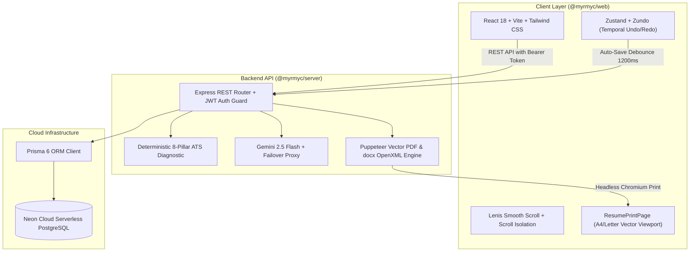

# myRmyC — myresume mycareer

[](https://www.typescriptlang.org/)
[](https://react.dev/)
[](https://nodejs.org/)
[](https://neon.tech/)
[](https://aistudio.google.com/)
[](https://tailwindcss.com/)
[](#license)

> **myRmyC** (*myresume mycareer*) is an enterprise-grade, multi-tenant career acceleration platform and ATS document studio. Designed with an **Editorial Neo-Brutalist & Tactile Hardware UI** aesthetic, myRmyC eliminates generic AI resume templates in favor of deterministic Applicant Tracking System (ATS) scoring, Google X-Y-Z quantitative bullet optimization, full Kanban application tracking, and 100% selectable vector PDF and DOCX generation.

---

## 1. System Architecture



---

## 2. Monorepo Structure

```text
myRmyC/
├── apps/
│   ├── server/                         # Express + TypeScript Backend (@myrmyc/server)
│   │   ├── prisma/
│   │   │   ├── schema.prisma           # Normalized PostgreSQL schema with Prisma ORM
│   │   │   └── seed.ts                 # Idempotent DB seeder (Templates + Demo Users)
│   │   ├── src/
│   │   │   ├── controllers/            # Route controllers (Auth, Resumes, ATS, AI, Export)
│   │   │   ├── middleware/             # JWT auth, Ownership guard, Error handlers
│   │   │   ├── repositories/           # Data access layer (Prisma queries)
│   │   │   ├── services/               # Export engine (PDF/DOCX), AI service, ATS engine
│   │   │   └── server.ts               # Express bootstrap and middleware pipeline
│   │   └── .env.example                # Server environment template
│   └── web/                            # React 18 + Vite Frontend (@myrmyc/web)
│       ├── src/
│       │   ├── components/
│       │   │   ├── editor/             # Accordion forms, Diff review modal, Paper canvas
│       │   │   ├── layout/             # Sidebar navigation, App header
│       │   │   ├── templates/          # 6 Pure ATS-compliant template renderers
│       │   │   └── ui/                 # Accessible primitives (Noise overlay, Toasts)
│       │   ├── context/                # AuthContext, ToastContext
│       │   ├── hooks/                  # useLenis smooth scroll hook
│       │   ├── pages/                  # Route views (Dashboard, Editor, ATS Checker, Kanban)
│       │   └── store/                  # Zustand + Zundo temporal document store
│       └── .env.example                # Client environment template
└── packages/
    └── shared/                         # Shared TypeScript interfaces & Zod schemas (@resumeforge/shared)
        └── src/
            ├── api.schema.ts           # DTOs, request/response validation schemas
            ├── ats.constants.ts        # Action verbs, weak phrases, pillar weights
            ├── resume.schema.ts        # Canonical ResumeDocument schema
            └── seed.data.ts            # Canonical anonymized student & SWE profiles
```

---

## 3. Key Capabilities & Engineering Standards

### 3.1 Deterministic 8-Pillar ATS Diagnostic Engine
Evaluates resume documents across 8 mathematical pillars yielding an unambiguous 0–100 score:
- **Contact Completeness (12 pts):** Validates full name, email, phone, location, and professional links.
- **Standard Section Headings (12 pts):** Inspects recognized ATS standard terminology.
- **Section Completeness (14 pts):** Validates required technical depth and education milestones.
- **Action Verb Strength (14 pts):** Detects assertive power verbs vs. weak passive participations.
- **Quantifiable Impact (16 pts):** Detects Google X-Y-Z metrics, throughput units, percentages, and financial figures.
- **Formatting & Safety (12 pts):** Enforces safe single-page word count density (380–700 words).
- **Consistency & Repetition (10 pts):** Prevents repetitive verb openings and syntax clashing.
- **Keyword Alignment (10 pts):** Computes intersection between candidate profile and target job descriptions.

### 3.2 Dual-Engine AI Bullet Optimization with Metric Calibration
- Powered by **Google Gemini 2.5 Flash** with deterministic NLP heuristic failover.
- Enforces Google's X-Y-Z formula: *"Accomplished [X] as measured by [Y], by doing [Z]"*.
- Metric Placeholders: Automatically wraps benchmark targets in editable amber chips (e.g. `[35%]`, `[10,000+ users]`). Users can calibrate metrics directly in the diff modal before committing changes.
- Provider Tagging: Emits `provider: 'gemini-2.5-flash'` or `provider: 'heuristic-fallback'` on every API payload.

### 3.3 100% Vector Selectable PDF & DOCX Generation
- **Puppeteer Headless Engine:** Renders the print payload at real 1:1 physical dimensions (`210mm x 297mm` for A4, `8.5in x 11in` for US Letter).
- **Zero Transform Scaling:** Avoids CSS scaling distortions during PDF generation to maintain 100% selectable, OCR-free text coordinates and valid clickable hyperlinks (`mailto:`, `https://`).
- **Font Readiness Guard:** Awaits `document.fonts.ready` prior to vector capture.
- **DOCX OpenXML Engine:** Programmatically synthesizes clean `.docx` archives using normalized OpenXML paragraphs, custom styles, and clean heading hierarchies.

### 3.4 Smooth Inertial Scrolling with Strict Scroll Isolation
- Modernized with official `lenis`.
- Embedded containers (Editor form rail, Live canvas viewport, Modal dialogs) utilize `data-lenis-prevent` to ensure zero scroll hijacking or nested jitter.

---

## 4. Quickstart Guide

### 4.1 Prerequisites
- **Node.js:** `v20.x` or higher
- **npm:** `v10.x` or higher
- **Neon Cloud PostgreSQL Account:** [neon.tech](https://neon.tech)
- **Google Gemini API Key (Optional for live LLM):** [Google AI Studio](https://aistudio.google.com/)

### 4.2 Installation & Setup

1. **Clone the repository:**
   ```bash
   git clone https://github.com/your-org/myRmyC.git
   cd myRmyC
   ```

2. **Install all monorepo dependencies:**
   ```bash
   npm install
   ```

3. **Configure Environment Variables:**
   - Copy the server environment template:
     ```bash
     cp apps/server/.env.example apps/server/.env
     ```
   - Provide your Neon PostgreSQL connection string and Gemini API key in `apps/server/.env`:
     ```env
     PORT=5000
     NODE_ENV=development
     CLIENT_URL=http://localhost:5173
     DATABASE_URL="postgresql://<user>:<password>@<neon-pooler-host>/neondb?sslmode=require"
     DATABASE_URL_UNPOOLED="postgresql://<user>:<password>@<neon-direct-host>/neondb?sslmode=require"
     JWT_ACCESS_SECRET="your-jwt-access-secret-32-chars-min"
     JWT_REFRESH_SECRET="your-jwt-refresh-secret-32-chars-min"
     GEMINI_API_KEY="your-gemini-api-key"
     ```

4. **Synchronize Database Schema & Seed Data:**
   ```bash
   # Push Prisma schema to Neon PostgreSQL
   npm run db:push

   # Seed official ATS templates and sandbox demo accounts
   npm run db:seed
   ```

5. **Start Development Servers:**
   ```bash
   npm run dev
   ```
   - Frontend Studio: [http://localhost:5173](http://localhost:5173)
   - Backend API: [http://localhost:5000](http://localhost:5000)

---

## 5. Pre-Configured Sandbox Demo Identities

For evaluation, testing, or recruiter walkthroughs, the database seeder pre-provisions two sandbox accounts:

| Role | Email | Password | Access Level |
| :--- | :--- | :--- | :--- |
| **Demo Administrator** | `demo@myrmyc.app` | `MyRmyC2026!` | Full Admin & Studio Access |
| **Alex Rivera (SWE)** | `alex.rivera@myrmyc.app` | `MyRmyC2026!` | Pre-loaded SWE Resume & Kanban Pipeline |

> [!TIP]
> Use the **1-Click Sandbox Access** buttons on the Sign In page (`/login`) for instantaneous one-click authenticated entry.

---

## 6. Verification & Quality Gate Matrix

| Phase | Description | Status | Verification Command |
| :--- | :--- | :--- | :--- |
| **Phase 1** | Brand Typography & Normalization (`myRmyC — myresume mycareer`) | `VERIFIED` | Zero legacy typos (0 hits) |
| **Phase 2** | Credential Sanitization (`demo@myrmyc.app`, `.env.example`) | `VERIFIED` | `npm run db:seed` (Success on Neon DB) |
| **Phase 3** | Lenis Modernization & `data-lenis-prevent` Scroll Isolation | `VERIFIED` | `npm run test --workspace=@myrmyc/web` |
| **Phase 4** | 100% Vector Selectable PDF & DOCX Engine Hardening | `VERIFIED` | `npm run test --workspace=@myrmyc/server` |
| **Phase 5** | Gemini 2.5 Flash + Heuristic Parity with Interactive Metric Chips | `VERIFIED` | Full schema & modal verification |
| **Phase 6** | Comprehensive Documentation & Repo Polish | `VERIFIED` | Root `README.md` complete |
| **Phase 7** | Full Monorepo Build & Type Check Gate | `VERIFIED` | `npm run test && npm run build` |

---

## 7. Scripts Reference

- `npm run dev`: Runs frontend and backend concurrently in watch mode.
- `npm run build`: Compiles `@resumeforge/shared`, builds backend TypeScript, and generates production Vite client bundle.
- `npm run test`: Executes strict `tsc --noEmit` across all monorepo packages.
- `npm run db:push`: Synchronizes Prisma schema with Neon PostgreSQL.
- `npm run db:seed`: Seeds templates, sandbox accounts, and sample resumes into Neon PostgreSQL.

---

## 8. License

Distributed under the MIT License. Built for engineers, students, and professionals striving for career excellence.
